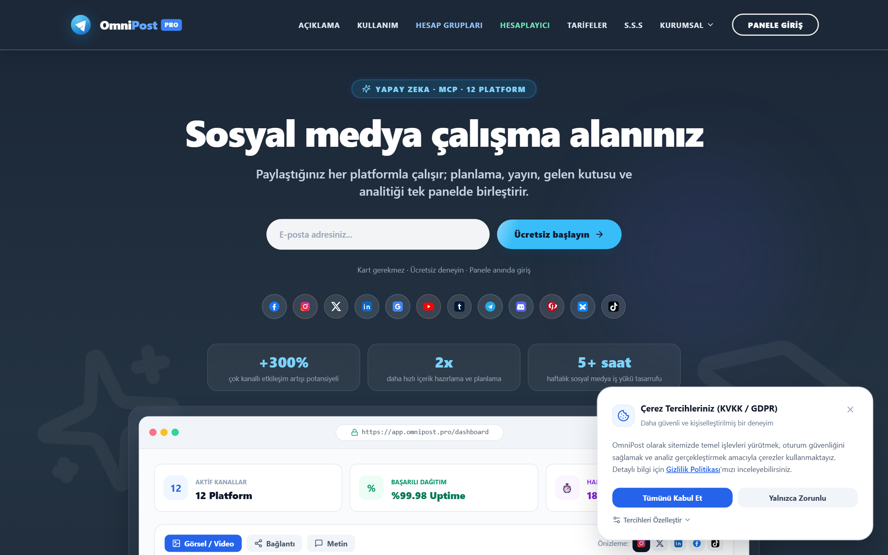
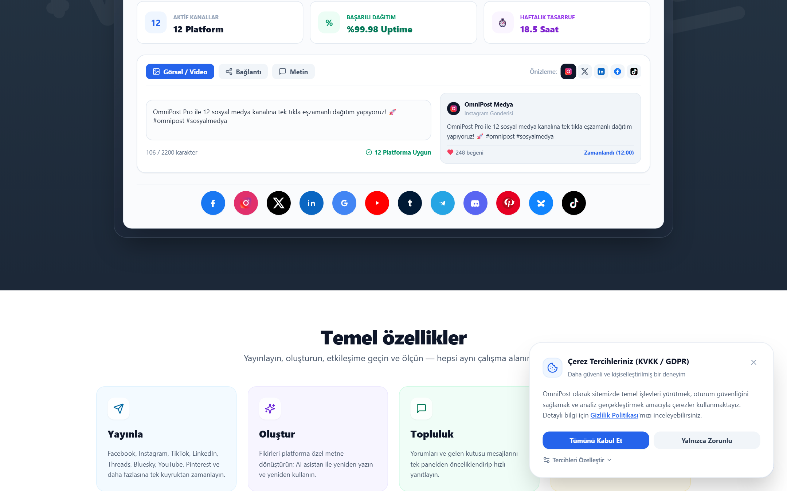
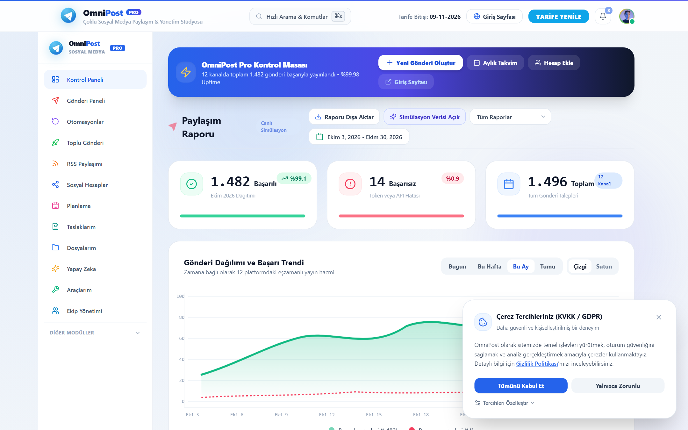
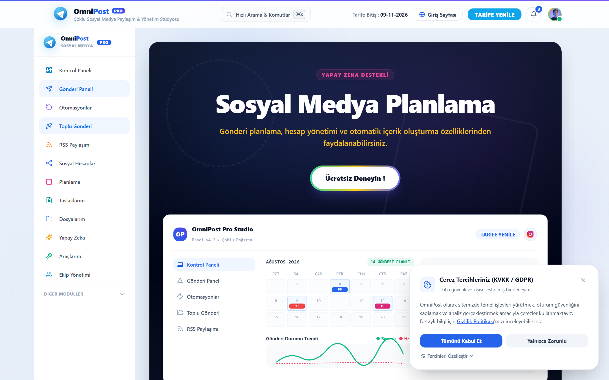
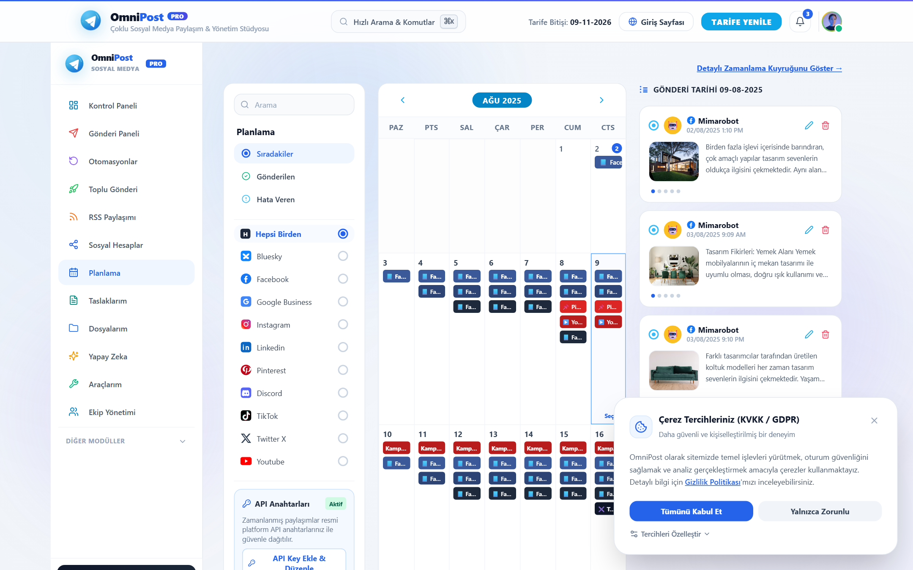
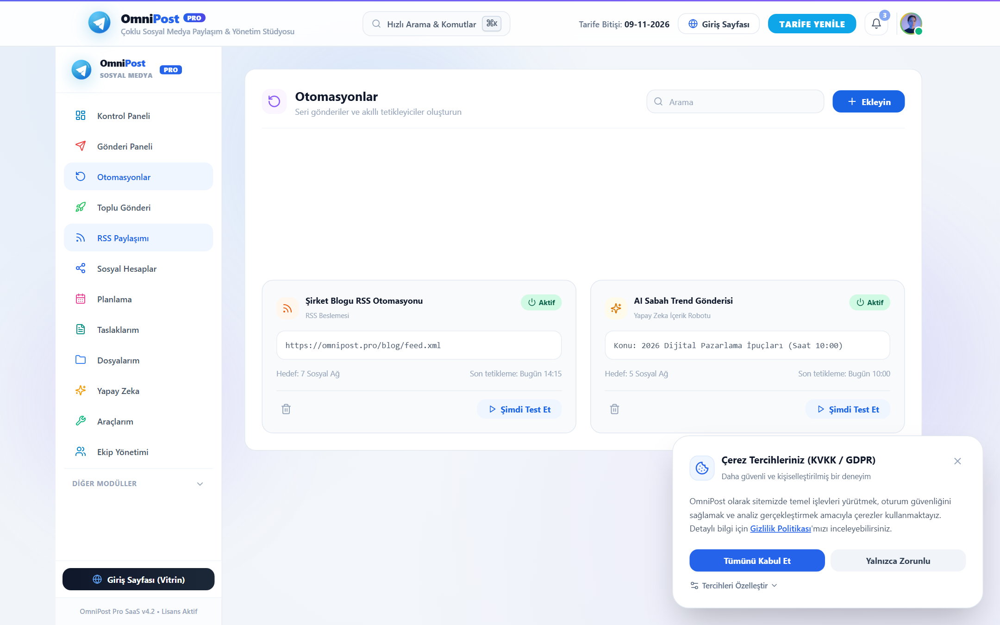

# 🚀 OmniPost Pro — Çok Kanallı Sosyal Medya & Dağıtım Stüdyosu

[](https://omnipostnew.vercel.app/)
[](https://github.com/23MAR47/OmniPost)
[](https://nextjs.org/)

OmniPost Pro, modern içerik üreticileri, pazarlamacılar ve yazılım ekipleri için geliştirilmiş açık kaynaklı ve yüksek performanslı bir çok kanallı sosyal medya yönetim platformudur.

🌐 **Canlı Uygulama:** [https://omnipostnew.vercel.app/](https://omnipostnew.vercel.app/)


---

## 📸 OmniPost Pro Arayüz & Ekran Görüntüleri Galerisi

Aşağıdaki tüm ekran görüntüleri doğrudan **[https://omnipostnew.vercel.app/](https://omnipostnew.vercel.app/)** üzerinde çalışan güncel OmniPost Pro uygulamasına aittir:

### 1. 🌟 Giriş ve Tanıtım Sayfası (Landing Page Hero)
> 12 sosyal medya platformuna tek tıkla eşzamanlı dağıtım sunan modern karşılama ekranı.


---

### 2. 📱 İnteraktif Canlı Önizleme ve Gönderi Simülatörü
> Instagram, Facebook, X ve LinkedIn için canlı cihaz mockup'ları ve anlık içerik önizlemesi.


---

### 3. 💰 ROI Tasarruf Hesaplayıcı ve Şeffaf Tarifeler
> Haftalık zaman kazanımı ve maliyet tasarrufu hesaplayıcı modülü.


---

### 4. 📊 Ana Kontrol Paneli (Management Dashboard)
> Hesap bağlantı durumları, hızlı paylaşım araçları ve genel sistem istatistikleri.


---

### 5. 🎨 Çok Kanallı Gönderi Paneli (Publishing Studio)
> Tek merkezden metin, görsel ve video uyarlamasıyla tüm ağlara eşzamanlı yayın stüdyosu.


---

### 6. 🔐 12 Sosyal Ağ Hesap Yönetimi & Token Kasası
> AES-256 şifreli OAuth 2.0 PKCE oturumları ve bağlantı sağlık monitörü.


---

### 7. 📅 Akıllı Planlama & Zaman Takvimi
> İleri tarihli paylaşımlar, sürükle-bırak takvim ve otomatik kuyruk yönetimi.


---

### 8. ⚡ Otomasyonlar & RSS Dağıtım Merkezi
> Otomatik RSS akışı dinleme ve akıllı içerik tetikleme otomasyonları.


---

## ✨ Temel Özellikler

* **Çoklu Platform Dağıtımı (Omni Dispatcher):** YouTube, X (Twitter), Instagram, Facebook, TikTok, Pinterest ve Threads hesaplarına tek tıkla eşzamanlı içerik yayını.
* **Akıllı Karakter & Format Validasyonu:** Her platformun karakter sınırları (ör. X için 280), medya kuralları ve en boy oranları için anlık pre-flight denetimi.
* **AES-256 Şifreli Token Vault:** API anahtarlarınızı ve OAuth token'larınızı güvenli şifreleme ve maskeleme katmanıyla saklar.
* **Gelişmiş AI Copywriting Motoru:** Viral kancalar (hooks), niş odaklı içerik üretimi ve akıllı hashtag önerileri.
* **Zamanlanmış Gönderi & Kuyruk Yönetimi:** İleri tarihli paylaşımlar, otomatik worker denetimi ve takvim görünümü.
* **Analitik & Excel Raporlama:** Gerçek zamanlı etkileşim metrikleri ve tek tıkla OpenXML `.xlsx` rapor çıktısı.
* **PWA & Mobil Uyum:** Çevrimdışı destek, mobil alt gezinme menüsü ve duyarlı modern tasarım.

---

## 🛠️ Teknoloji Yığını

* **Framework:** [Next.js 14](https://nextjs.org/) (App Router)
* **Arayüz:** [React 18](https://react.dev/), [Tailwind CSS](https://tailwindcss.com/)
* **İkonlar:** [Lucide React](https://lucide.dev/)
* **Tip Güvenliği:** TypeScript 5.6
* **Kriptografi:** Node.js Crypto (AES-256)

---

## 🚀 Başlangıç

### 1. Bağımlılıkları Yükleyin
```bash
npm install
```

### 2. Geliştirici Sunucusunu Başlatın
```bash
npm run dev
```
Tarayıcınızda [http://localhost:3000](http://localhost:3000) adresini açın.

### 3. Üretim Derlemesi (Build)
```bash
npm run build
npm run start
```

---

## 📄 Lisans
MIT License © 2026 OmniPost Team
