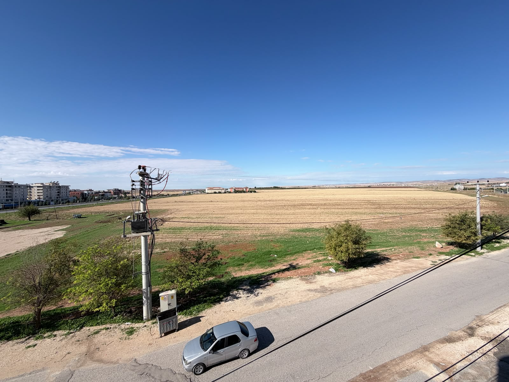
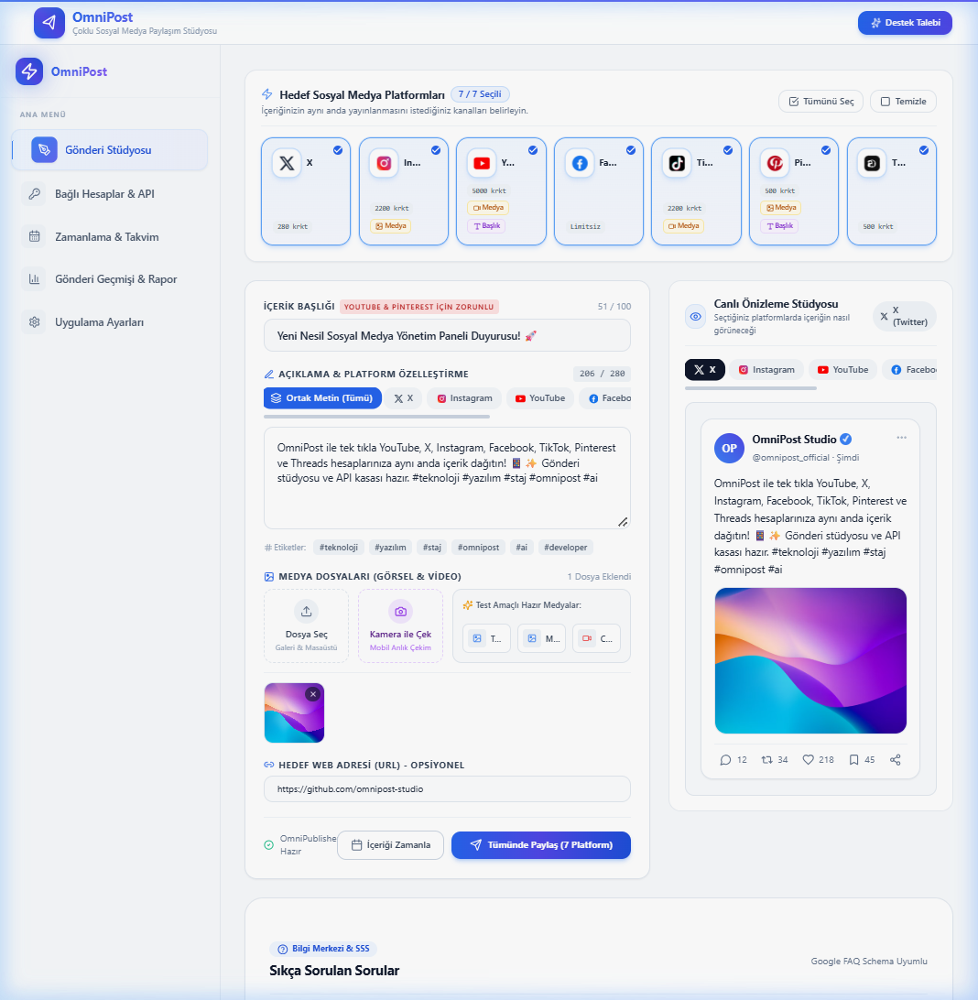
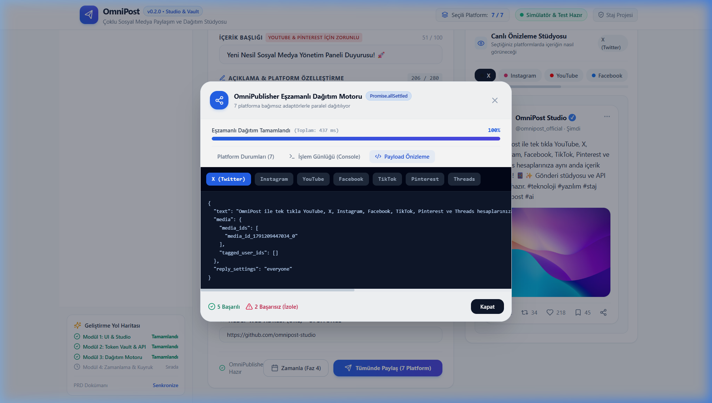
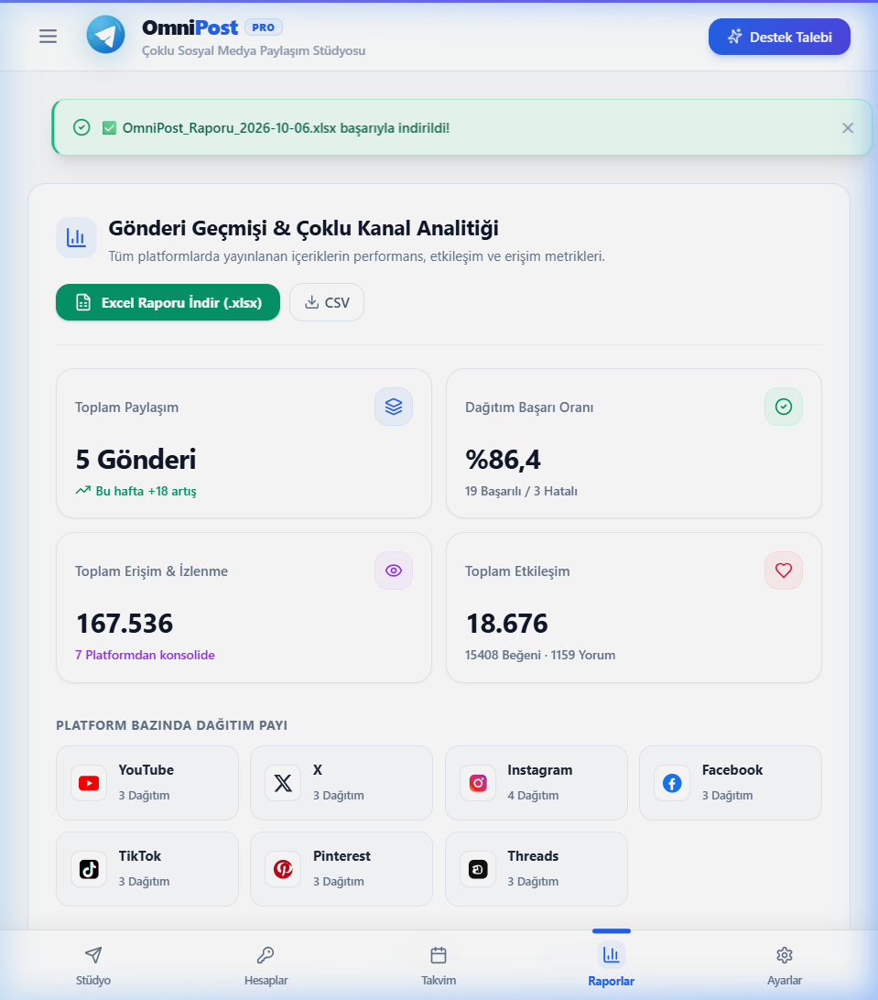
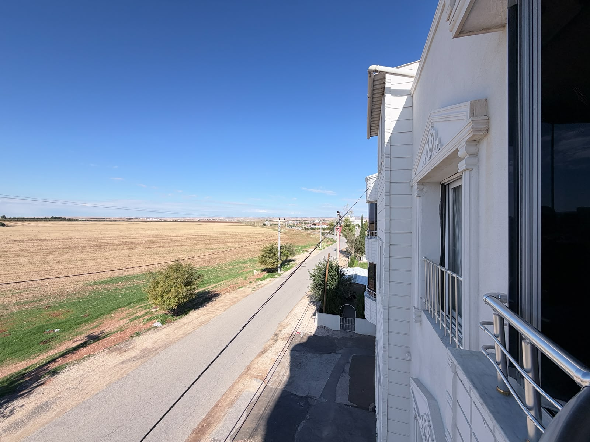
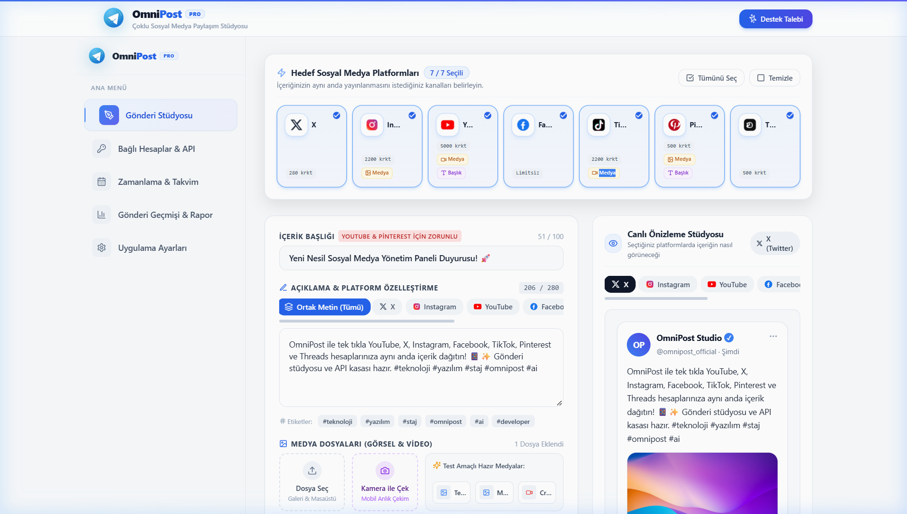
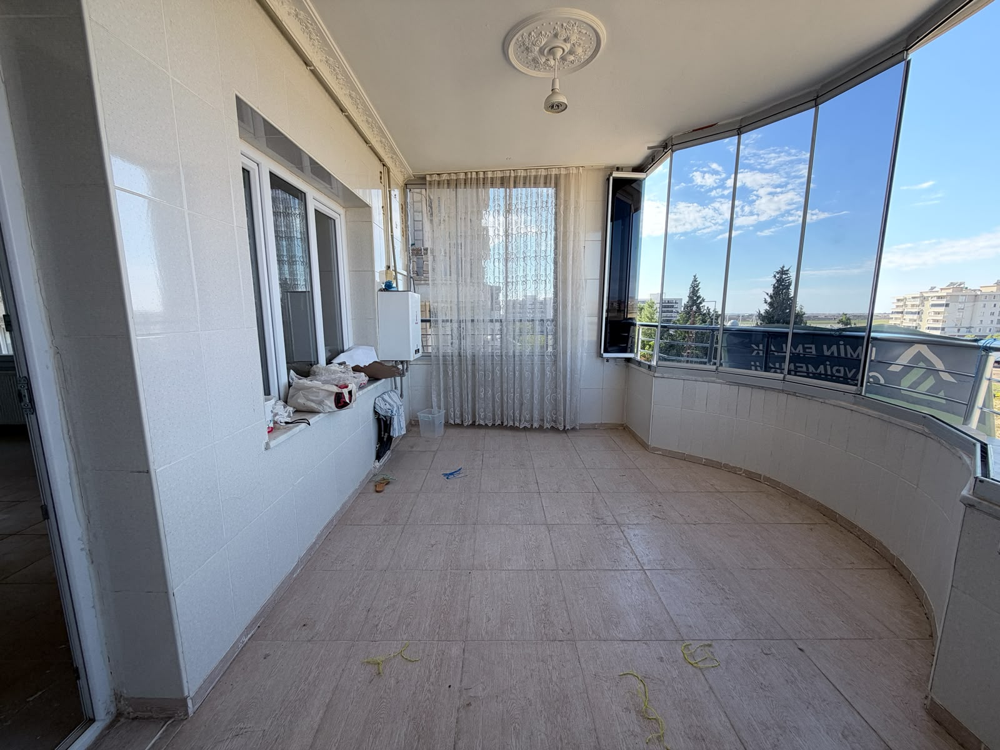
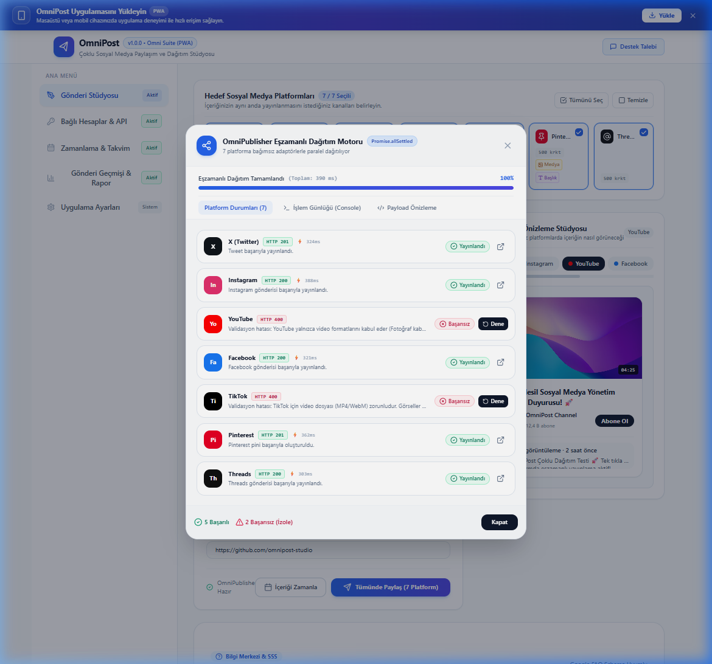
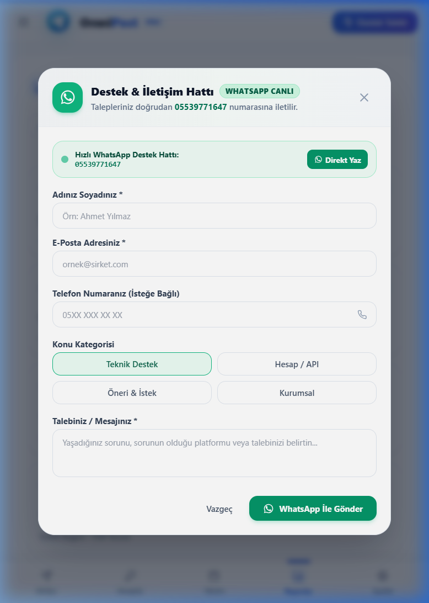

# 🚀 OmniPost Pro — Çok Kanallı Sosyal Medya & Dağıtım Stüdyosu

[](https://omnipost.vercel.app/)
[](https://github.com/23MAR47/OmniPost)
[](https://nextjs.org/)

OmniPost Pro, modern içerik üreticileri, pazarlamacılar ve yazılım ekipleri için geliştirilmiş açık kaynaklı ve yüksek performanslı bir çok kanallı sosyal medya yönetim platformudur.

🌐 **Canlı Uygulama:** [https://omnipost.vercel.app/](https://omnipost.vercel.app/)


---

## 🔄 Arayüz Evrimi: Eski Arayüz vs. Yeni Nesil OmniPost (Before & After)

Uygulamanın tasarım, performans ve kullanıcı deneyimi yolculuğundaki evrimi:

| Modül / Panel | 🕰️ Eski Arayüz (Before / Legacy) | 🚀 Yeni Nesil OmniPost Pro (After / Modern) |
| :--- | :---: | :---: |
| **1. İçerik Stüdyosu & Editör** |  |  |
| **2. Çoklu Platform Dağıtımı** |  |  |
| **3. Takvim, Zamanlama & Analitik** |  |  |
| **4. Güvenlik & Token Kasası** |  |  |
| **5. Kontrol Paneli & Dağıtım Onayı** |  |  |

---

## 📸 Yeni Nesil Arayüz & Ekran Görüntüleri Galerisi

### 1. 🎨 İçerik Editörü ve Çok Kanallı Canlı Önizleme (Studio Editor)
> Tek bir merkezden tüm sosyal ağlar için özel metin, görsel ve video uyarlaması.


---

### 2. ⚡ Çoklu Platform Eşzamanlı Dağıtım Motoru (Concurrent Dispatcher)
> YouTube, X, Instagram, Facebook, TikTok, Pinterest ve Threads hesaplarına anlık paralel yayın.


---

### 3. 📊 Gerçek Zamanlı Analitik ve Etkileşim Raporları
> Gönderi performansı, erişim grafikleri ve tek tıkla Excel (.xlsx) ihracı.


---

### 4. 🔐 AES-256 Şifreli Token Kasası (Zero-Leak Token Vault)
> OAuth 2.0 PKCE oturumları, API anahtarı maskelemesi ve bağlantı sağlık monitörü.


---

### 5. 👥 Destek, Geri Bildirim ve Onay Motoru
> Takım içi onay akışları ve kullanıcı destek biletleri.


---

### 6. ✅ Başarılı Dağıtım ve Yayın Onay Ekranı
> HTTP 201 Created durum kodları ve platform bazlı canlı gönderi linkleri.


---

## ✨ Temel Özellikler

* **Çoklu Platform Dağıtımı (Omni Dispatcher):** YouTube, X (Twitter), Instagram, Facebook, TikTok, Pinterest ve Threads hesaplarına tek tıkla eşzamanlı içerik yayını.
* **Akıllı Karakter & Format Validasyonu:** Her platformun karakter sınırları (ör. X için 280), medya kuralları ve en boy oranları için anlık pre-flight denetimi.
* **AES-256 Şifreli Token Vault:** API anahtarlarınızı ve OAuth token'larınızı güvenli şifreleme ve maskeleme katmanıyla saklar.
* **Gelişmiş AI Copywriting Motoru:** Viral kancalar (hooks), niş odaklı içerik üretimi ve akıllı hashtag önerileri.
* **Zamanlanmış Gönderi & Kuyruk Yönetimi:** İleri tarihli paylaşımlar, otomatik worker denetimi ve takvim görünümü.
* **Analitik & Excel Raporlama:** Gerçek zamanlı etkileşim metrikleri ve tek tıkla OpenXML `.xlsx` rapor çıktısı.
* **PWA & Mobil Uyum:** Çevrimdışı destek, mobil alt gezinme menüsü ve duyarlı modern tasarım.

---

## 🛠️ Teknoloji Yığını

* **Framework:** [Next.js 14](https://nextjs.org/) (App Router)
* **Arayüz:** [React 18](https://react.dev/), [Tailwind CSS](https://tailwindcss.com/)
* **İkonlar:** [Lucide React](https://lucide.dev/)
* **Tip Güvenliği:** TypeScript 5.6
* **Kriptografi:** Node.js Crypto (AES-256)

---

## 🚀 Başlangıç

### 1. Bağımlılıkları Yükleyin
```bash
npm install
```

### 2. Geliştirici Sunucusunu Başlatın
```bash
npm run dev
```
Tarayıcınızda [http://localhost:3000](http://localhost:3000) adresini açın.

### 3. Üretim Derlemesi (Build)
```bash
npm run build
npm run start
```

---

## 📄 Lisans
MIT License © 2026 OmniPost Team
